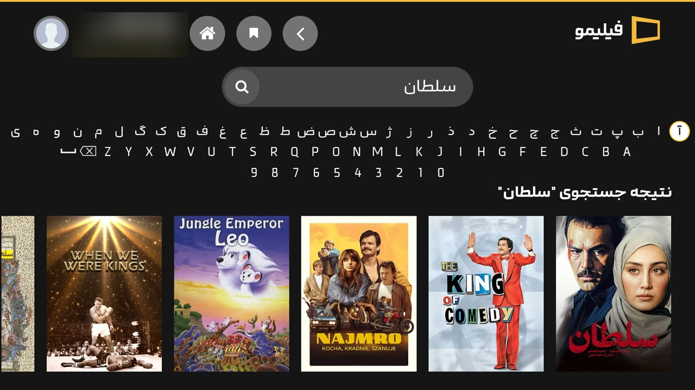

<h1 align="center">
  <br>
  فیلیمو برای تلویزیون ال جی<br>
  Filimo for LG TV (webOS)
</h1>

<p align="center">
  <a href="https://github.com/hamedafra/filimo-webos/releases/latest"></a>
  <a href="https://github.com/hamedafra/filimo-webos/releases"></a>
  
</p>

<p align="center">
  <a href="#فارسی">فارسی</a> · <a href="#english">English</a>
</p>

<p align="center">
  
  <br><br>
  
</p>

---

<div dir="rtl">

## فارسی

**فیلیمو برای تلویزیون ال جی** یک برنامه‌ی غیررسمی است که فیلیمو را روی تلویزیون‌های هوشمند **LG** (سیستم‌عامل **webOS**) نصب می‌کند؛ هم روی تلویزیون‌های **روت‌شده** و هم **روت‌نشده**.

### ویژگی‌ها

- ✅ نسخه‌ی تلویزیونی خود فیلیمو، مخصوص کار با ریموت
- ✅ **کیبورد فارسی** در صفحه‌ی جستجو (کیبورد خود تلویزیون‌های ال جی معمولاً فارسی ندارد)
- ✅ ورود آسان با کد، از طریق گوشی
- ✅ دکمه‌ی برگشت ریموت درست کار می‌کند
- ✅ رایگان؛ فقط به اشتراک فیلیمو نیاز دارید

### دانلود

آخرین نسخه را از صفحه‌ی **[دانلودها (Releases)](https://github.com/hamedafra/filimo-webos/releases/latest)** بگیرید. فایلی که لازم دارید، فایلی است که اسمش با `.ipk` تمام می‌شود.

### کدام روش نصب برای من است؟

| تلویزیون شما | روش پیشنهادی |
|---|---|
| برنامه‌ی **Homebrew Channel** روی تلویزیون نصب است (معمولاً یعنی روت شده) | [روش ۱: نصب از داخل تلویزیون](#روش-۱-نصب-از-داخل-تلویزیون-با-homebrew-channel) |
| تلویزیون روت نشده و Homebrew Channel ندارد | [روش ۲: نصب با کامپیوتر (حالت توسعه‌دهنده)](#روش-۲-نصب-با-کامپیوتر-برای-تلویزیون‌های-روت‌نشده) |

---

### روش ۱: نصب از داخل تلویزیون با Homebrew Channel

این ساده‌ترین روش است و کامپیوتر لازم ندارد. نسخه‌های جدید هم از همین‌جا نصب می‌شوند.

1. برنامه‌ی **Homebrew Channel** را روی تلویزیون باز کنید.
2. بالای صفحه، روی آیکون **چرخ‌دنده (Settings)** بروید.
3. پایین صفحه گزینه‌ی **Add repository** را بزنید.
4. این آدرس را با ریموت تایپ کنید و **Add repository** را بزنید:

   ```
   https://hamedafra.github.io/filimo-webos/apps.json
   ```

5. به صفحه‌ی اصلی Homebrew Channel برگردید. **Filimo** در فهرست برنامه‌ها اضافه شده است.
6. روی **Filimo** بروید و **Install** را بزنید.
7. تمام! آیکون فیلیمو در فهرست برنامه‌های تلویزیون ظاهر می‌شود.

> 💡 وقتی نسخه‌ی جدیدی منتشر شود، در Homebrew Channel روی Filimo بروید و دوباره **Install** را بزنید.

---

### روش ۲: نصب با کامپیوتر (برای تلویزیون‌های روت‌نشده)

در این روش تلویزیون را موقتاً در «حالت توسعه‌دهنده» (Developer Mode) قرار می‌دهید. این قابلیت رسمی خود ال جی است و به تلویزیون آسیبی نمی‌زند. لازم است تلویزیون و کامپیوتر به **یک مودم/وای‌فای** وصل باشند.

**قدم ۱: ساخت حساب توسعه‌دهنده‌ی ال جی (رایگان)**

1. در کامپیوتر یا گوشی به سایت **[webostv.developer.lge.com](https://webostv.developer.lge.com)** بروید.
2. با **Sign In** یک حساب جدید بسازید و ایمیلتان را تأیید کنید.

> ⚠️ ممکن است سایت ال جی از داخل ایران باز نشود؛ در این صورت فقط برای ساخت حساب از VPN استفاده کنید.

**قدم ۲: روشن کردن حالت توسعه‌دهنده روی تلویزیون**

1. روی تلویزیون، فروشگاه **LG Content Store** را باز کنید.
2. برنامه‌ی **Developer Mode** را جستجو و نصب کنید.
3. برنامه‌ی Developer Mode را باز کنید و با همان حسابی که ساختید وارد شوید.
4. گزینه‌ی **Dev Mode Status** را روشن کنید. تلویزیون یک بار خاموش و روشن می‌شود.
5. دوباره برنامه‌ی Developer Mode را باز کنید و گزینه‌ی **Key Server** را هم روشن کنید.
6. این صفحه را باز نگه دارید؛ **آدرس IP** و **Passphrase** (یک کد چندحرفی) که روی صفحه است را در قدم بعد لازم دارید.

**قدم ۳: نصب برنامه‌ی Dev Manager روی کامپیوتر**

1. برنامه‌ی **webOS Dev Manager** را از **[این صفحه](https://github.com/webosbrew/dev-manager-desktop/releases/latest)** دانلود و نصب کنید (برای ویندوز، مک و لینوکس).
2. برنامه را باز کنید و تلویزیون را اضافه کنید (**Add Device**):
   - نوع دستگاه را حالت توسعه‌دهنده (**Developer Mode**) انتخاب کنید.
   - **آدرس IP** تلویزیون را وارد کنید.
   - **Passphrase** را از صفحه‌ی تلویزیون وارد کنید.
3. اگر همه‌چیز درست باشد، تلویزیون در برنامه «وصل» نشان داده می‌شود.

**قدم ۴: نصب فیلیمو**

1. فایل `.ipk` را از **[صفحه‌ی دانلودها](https://github.com/hamedafra/filimo-webos/releases/latest)** دانلود کنید.
2. در Dev Manager به بخش **Apps** بروید.
3. روی دکمه‌ی نصب (**Install**) بزنید و فایل `.ipk` دانلودشده را انتخاب کنید (یا فایل را داخل پنجره بکشید).
4. تمام! آیکون **Filimo** در فهرست برنامه‌های تلویزیون ظاهر می‌شود.

> ⚠️ **مهم:** حالت توسعه‌دهنده مدت محدودی فعال می‌ماند و زمان باقی‌مانده داخل برنامه‌ی Developer Mode نمایش داده می‌شود. اگر این زمان تمام شود، برنامه‌هایی که خودتان نصب کرده‌اید (از جمله فیلیمو) از تلویزیون پاک می‌شوند. هر چند وقت یک بار برنامه‌ی Developer Mode را باز کنید و دکمه‌ی **Extend** را بزنید تا زمان تمدید شود.

---

### اولین استفاده: ورود به حساب فیلیمو

1. برنامه‌ی **Filimo** را روی تلویزیون باز کنید و گزینه‌ی **ورود** را بزنید.
2. یک کد روی صفحه‌ی تلویزیون نمایش داده می‌شود.
3. با گوشی یا کامپیوتر به **[filimo.com/activate](https://www.filimo.com/activate)** بروید، وارد حساب فیلیمو شوید و کد را وارد کنید.
4. تلویزیون خودکار وارد حساب شما می‌شود. 🎬

### پرسش‌های رایج

<details>
<summary><b>آیا این برنامه رسمی است؟</b></summary>

نه. این یک پروژه‌ی شخصی و غیررسمی است و هیچ ارتباطی با شرکت فیلیمو یا ال جی ندارد. برنامه فقط نسخه‌ی تلویزیونی خود سایت فیلیمو را باز می‌کند و برای تماشا به اشتراک فیلیمو نیاز دارید.
</details>

<details>
<summary><b>ویدیو پخش نمی‌شود یا برنامه باز نمی‌شود.</b></summary>

- مطمئن شوید اینترنت تلویزیون وصل است.
- اگر VPN یا پروکسی روی مودم یا تلویزیون روشن است، خاموشش کنید؛ فیلیمو معمولاً فقط با اینترنت ایران کار می‌کند.
- برنامه را کامل ببندید و دوباره باز کنید.
</details>

<details>
<summary><b>فیلیمو بعد از چند روز از تلویزیون پاک شد.</b></summary>

اگر از روش ۲ (حالت توسعه‌دهنده) استفاده کرده‌اید، زمان حالت توسعه‌دهنده تمام شده است. Developer Mode را دوباره روشن کنید، برنامه را دوباره نصب کنید و از این به بعد زمان را با دکمه‌ی **Extend** تمدید کنید.
</details>

<details>
<summary><b>کیبورد فارسی کجاست؟</b></summary>

در صفحه‌ی **جستجو**، زیر کادر جستجو. حروف فارسی، انگلیسی و اعداد را با دکمه‌های جهت ریموت انتخاب و با **OK** تایپ کنید.
</details>

<details>
<summary><b>چطور برنامه را حذف کنم؟</b></summary>

در فهرست برنامه‌های تلویزیون، روی آیکون Filimo دکمه‌ی OK را نگه دارید و گزینه‌ی حذف را بزنید. در Homebrew Channel یا Dev Manager هم گزینه‌ی حذف (Uninstall) وجود دارد.
</details>

<details>
<summary><b>نسخه‌ی جدید را چطور نصب کنم؟</b></summary>

- **روش ۱:** در Homebrew Channel روی Filimo بروید و دوباره Install را بزنید.
- **روش ۲:** فایل `.ipk` جدید را دانلود کنید و مثل قبل با Dev Manager نصب کنید. لازم نیست نسخه‌ی قبلی را حذف کنید.
</details>

</div>

---

## English

**Filimo for LG TV** is an unofficial app that brings [Filimo](https://www.filimo.com) to **LG Smart TVs running webOS**, on both **rooted** and **non-rooted** TVs.

### Features

- ✅ Filimo's own TV interface, made for the remote control
- ✅ **Persian on-screen keyboard** on the search page (LG's built-in keyboard usually has no Persian)
- ✅ Easy sign-in with a code from your phone
- ✅ The remote's Back button works as expected
- ✅ Free; you only need a Filimo subscription

### Download

Get the latest version from the **[Releases page](https://github.com/hamedafra/filimo-webos/releases/latest)**. The file you need is the one ending in `.ipk`.

### Which installation method is for me?

| Your TV | Recommended method |
|---|---|
| Has the **Homebrew Channel** app (usually means it's rooted) | [Method 1: Install from the TV](#method-1-install-from-the-tv-with-homebrew-channel) |
| Not rooted, no Homebrew Channel | [Method 2: Install with a computer](#method-2-install-with-a-computer-non-rooted-tvs) |

### Method 1: Install from the TV with Homebrew Channel

The easiest way. No computer needed, and updates come through the same place.

1. Open **Homebrew Channel** on your TV.
2. Go to the **gear icon (Settings)** at the top.
3. Choose **Add repository** at the bottom.
4. Type this address with the remote and press **Add repository**:

   ```
   https://hamedafra.github.io/filimo-webos/apps.json
   ```

5. Go back to the Homebrew Channel home screen. **Filimo** is now in the list.
6. Open **Filimo** and press **Install**.
7. Done! The Filimo icon appears in your TV's app list.

> 💡 When a new version is released, open Filimo in Homebrew Channel and press **Install** again.

### Method 2: Install with a computer (non-rooted TVs)

This uses LG's official **Developer Mode**. It's a built-in LG feature and does no harm to your TV. Your TV and computer must be on the **same Wi-Fi/router**.

**Step 1: Create a free LG developer account**

1. Go to **[webostv.developer.lge.com](https://webostv.developer.lge.com)** on your computer or phone.
2. Click **Sign In**, create a new account and confirm your email.

**Step 2: Turn on Developer Mode on the TV**

1. Open the **LG Content Store** on your TV.
2. Search for **Developer Mode** and install it.
3. Open the Developer Mode app and sign in with the account you created.
4. Turn on **Dev Mode Status**. The TV will restart once.
5. Open Developer Mode again and turn on **Key Server** too.
6. Keep this screen open: you'll need the **IP address** and the **Passphrase** shown on it.

**Step 3: Install Dev Manager on your computer**

1. Download and install **webOS Dev Manager** from **[this page](https://github.com/webosbrew/dev-manager-desktop/releases/latest)** (Windows, macOS and Linux).
2. Open it and add your TV (**Add Device**):
   - Choose **Developer Mode** as the device type.
   - Enter the TV's **IP address**.
   - Enter the **Passphrase** from the TV screen.
3. If everything is right, the TV shows as connected.

**Step 4: Install Filimo**

1. Download the `.ipk` file from the **[Releases page](https://github.com/hamedafra/filimo-webos/releases/latest)**.
2. In Dev Manager, go to **Apps**.
3. Click **Install** and choose the downloaded `.ipk` file (or drag it into the window).
4. Done! The **Filimo** icon appears in your TV's app list.

> ⚠️ **Important:** Developer Mode only stays on for a limited time; the remaining time is shown in the Developer Mode app. When it runs out, apps you installed yourself (including Filimo) are removed. Open the Developer Mode app every now and then and press **Extend**.

### First use: signing in to Filimo

1. Open **Filimo** on your TV and choose **Sign in** (ورود).
2. A code appears on the TV screen.
3. On your phone or computer, go to **[filimo.com/activate](https://www.filimo.com/activate)**, sign in to your Filimo account and enter the code.
4. Your TV signs in automatically. 🎬

### FAQ

<details>
<summary><b>Is this app official?</b></summary>

No. This is an unofficial personal project, not affiliated with Filimo or LG. The app simply opens Filimo's own TV website, and you need a Filimo subscription to watch.
</details>

<details>
<summary><b>Videos don't play or the app doesn't open.</b></summary>

- Make sure the TV is connected to the internet.
- If a VPN or proxy is on (on the router or TV), turn it off; Filimo usually only works with an Iranian internet connection.
- Fully close the app and open it again.
</details>

<details>
<summary><b>Filimo disappeared from my TV after a few days.</b></summary>

If you used Method 2, the Developer Mode time ran out. Turn Developer Mode back on, install the app again, and from now on press **Extend** regularly.
</details>

<details>
<summary><b>Where is the Persian keyboard?</b></summary>

On the **search** page, below the search box. Pick Persian letters, English letters or numbers with the arrow buttons and press **OK** to type.
</details>

<details>
<summary><b>How do I uninstall it?</b></summary>

In your TV's app list, hold OK on the Filimo icon and choose remove. Homebrew Channel and Dev Manager also have an Uninstall option.
</details>

<details>
<summary><b>How do I update?</b></summary>

- **Method 1:** Open Filimo in Homebrew Channel and press Install again.
- **Method 2:** Download the new `.ipk` and install it with Dev Manager as before. No need to remove the old version.
</details>

---

<sub>Disclaimer: Filimo and the Filimo logo belong to their respective owner. This project is not affiliated with, endorsed by, or sponsored by Filimo or LG Electronics. · Developers: run `python3 build.py` to build the `.ipk` from the `app/` folder.</sub>
